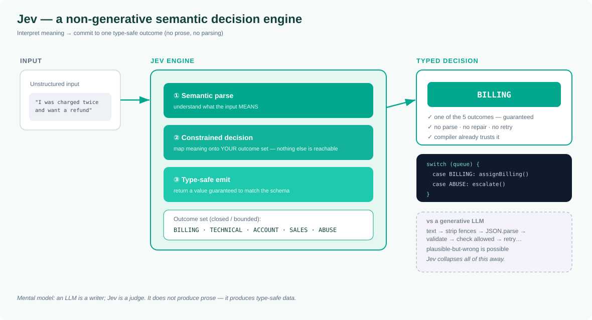
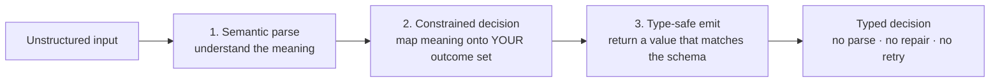

# Jev — What It Is, What It's For, and How to Think About It

> **In one sentence:** Jev is a **non-generative semantic decision engine** — it interprets the *meaning* of an input and returns **type-safe, structured data** (a decision, a classification, a routed action), never free-form prose.

If an LLM is a **writer**, Jev is a **judge**. One produces text you then have to parse and trust; the other produces a typed value your code can act on directly.



---

## What is Jev?

Jev takes **unstructured input + a defined set of possible outcomes**, understands what the input *means*, and commits to **exactly one valid, typed result** from that set. It does not generate sentences, summaries, or explanations — it generates **data that conforms to a type you defined up front**.

Three properties define it:

- **Non-generative** — it doesn't predict "the next word." It *decides*.
- **Semantic** — it works from the *meaning* of the input, not keyword matching or rigid rules.
- **Type-safe** — the output is guaranteed to match a declared type; an invalid answer is not reachable.

> The core idea in one line: **Jev does not produce prose; it produces type-safe data.**

---

## Purpose — the problem Jev solves

Most software doesn't want a paragraph — it wants **an answer it can act on**:

- Is this transaction fraud? → `true | false`
- Which queue does this support ticket belong to? → an enum
- What's the risk tier of this application? → `LOW | MEDIUM | HIGH`
- Should this content be allowed, flagged, or blocked? → a policy decision

When you force a generative model to answer these, you hit four recurring problems — and Jev's purpose is to remove all four:

| Problem with generative output | How Jev addresses it |
|-------------------------------|----------------------|
| **Format drift** — sometimes valid JSON, sometimes an apology or a stray field | Output is a **typed value** by construction — no parsing/repair |
| **Hallucination** — confidently wrong, but *plausible* | Output space is **closed** to your defined outcomes |
| **Non-determinism** — same input, different answers | **Decision-oriented and reproducible** |
| **No contract** — "return a category" is only a request | The **type is the contract**, enforced at the boundary |

**Purpose, stated plainly:** give systems a way to turn meaning into a *bounded, trustworthy, typed decision* — so the result can flow straight into code without a validate-and-hope layer.

---

## Where Jev is used

Reach for Jev whenever the output **feeds code**, not a human reader, and being *wrong-but-plausible* is unacceptable.

| Use case | Input | Typed output |
|----------|-------|--------------|
| **Classification / labeling** | A document, message, image caption | A category enum |
| **Routing** | A ticket, lead, alert, email | The destination queue/team |
| **Content moderation** | User-generated content | `ALLOW \| FLAG \| BLOCK` + reasons |
| **Risk scoring / tiering** | An application, transaction | `LOW \| MEDIUM \| HIGH` (+ flags) |
| **Structured extraction** | Free text | A typed object (fields constrained) |
| **Intent detection** | A user utterance | One of a fixed set of intents |
| **Policy gates** | A request + context | A permit/deny decision |

**Where *not* to use Jev:** when the output genuinely *is* language — drafting, summarizing, chatting, code generation. That's a generative LLM's job. The strongest systems use **both**: an LLM for the language, Jev at every point where the system must *commit* to a bounded, auditable outcome.

---

## Core terminology

The vocabulary you need to reason about Jev:

| Term | Meaning |
|------|---------|
| **Decision** | The single typed value Jev returns for an input — the core output. |
| **Non-generative** | Jev selects an outcome; it does not generate free text. |
| **Semantic interpretation** | Understanding the *meaning* of the input (not keywords/regex) to reach the decision. |
| **Type-safe output** | The result is guaranteed to conform to a declared type; invalid results are impossible. |
| **Outcome set** | The closed, finite set of possible results you define (e.g. an enum or union). |
| **Output space** | The full range of things Jev could return — always **bounded** by the outcome set. |
| **Schema / contract** | The type definition that specifies the allowed shape and values of the output. |
| **Determinism** | The property that the same input yields the same decision — key for auditing. |
| **Bounded output** | The guarantee that no result falls outside the defined outcome set. |
| **Structured data** | Machine-usable output (enums, booleans, typed objects) — not prose. |
| **Judge (vs writer)** | The mental model: Jev *renders a verdict*; an LLM *writes*. |
| **Auditability** | Because outcomes are enumerable and reproducible, every possible decision can be listed and tested. |

---

## How Jev works (conceptually)

Internally, think of three stages — but you only ever see the final typed result:



The defining property is that the **output space is closed**: if your type has five options, the decision is one of those five. There's no sixth outcome, no free text, no "sorry, I can't help" leaking into your data layer.

### Illustrative shape

```text
Declare the outcome set  →  Hand Jev the input  →  Get back the typed value

  type SupportQueue = BILLING | TECHNICAL | ACCOUNT | SALES | ABUSE

  queue = jev.decide("I was charged twice and want a refund")
  # → BILLING  (guaranteed to be one of the five; never a sentence)

  switch (queue) { ... }   # use it directly — the compiler already trusts it
```

*(Syntax is illustrative — adapt to Jev's actual API. The point is the shape: declare a type, get that type back.)*

---

## Jev vs an LLM — at a glance

| | Generative LLM | Jev |
|---|---|---|
| **Core operation** | Predict the next token | Interpret meaning → select an outcome |
| **Output** | Free-form text | Type-safe structured data |
| **Output space** | Effectively unbounded | Bounded by your outcome set |
| **Failure mode** | Plausible but wrong text | Constrained — always a valid type |
| **Determinism** | Probabilistic by default | Decision-oriented, reproducible |
| **Best at** | Writing, ideation, dialogue | Classification, routing, policy, extraction |
| **Mental model** | A writer | A judge |

---

## Why it matters

Because a Jev decision is **bounded, reproducible, and typed**, you get properties free-text generation can't offer:

- **Auditable** — the output space is enumerable; you can list every decision it could make.
- **Testable** — unit-test decisions with fixed inputs and assert on typed values.
- **Safe by construction** — invalid outputs aren't caught after the fact; they're impossible.
- **No injection-via-output** — the engine can't smuggle instructions into your data layer as free text, because the output isn't text.

These are exactly the properties that auditable, compliance-heavy domains (finance, healthcare, access control, moderation) need.

---

## The one-line summary

> An LLM **writes**; Jev **judges**. One returns prose you must parse and trust. The other returns a typed value your type system already trusts.

---

*This page describes Jev as a non-generative semantic decision engine that produces type-safe data rather than prose. Terminology and examples here are conceptual; align the specifics with Jev's actual API and documentation before relying on them.*
